<p align="center">
  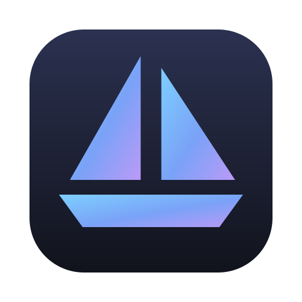
</p>

<h1 align="center">Masthead</h1>

<p align="center">
  A fast, native, multi-cluster Kubernetes explorer for macOS.<br>
  Built in Rust with <a href="https://www.gpui.rs">GPUI</a>, the UI framework behind the Zed editor.
</p>

<p align="center">
  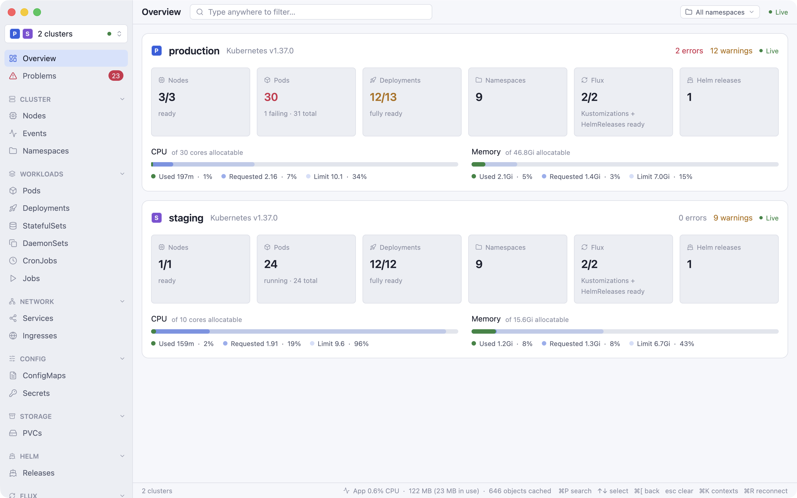
</p>

> [!NOTE]
> **Masthead is entirely AI-coded.** All of the code, scripts, icon and docs were written by
> [Claude Code](https://claude.com/claude-code) through conversation, with no hand-written code. A human
> drove it: chose the features, tested them against real clusters and reported what looked or felt wrong.
> Treat it as an experiment, and read the code before trusting it with a production cluster.
> Delete and redeploy actions run without a confirmation dialog.

## Why

Tools like Aptakube and Lens are great, but heavy. Masthead is a single ~20 MB native binary, about
10k lines of Rust. It watches every resource kind of every selected cluster live, so pages switch instantly,
and it idles at around 1% CPU.

## Features

- **Multi-cluster.** Tick several contexts and their rows merge into one table, with a colour per
  cluster. Kubeconfig files can be added from the app.
- **Live everything.** Every kind is kept up to date through Kubernetes watches, with no polling or
  refresh button.
- **Overview and Problems.** One card per cluster shows health, capacity, Flux and Helm. The Problems
  page collects crash-looping pods, failed jobs, unready nodes, broken Flux objects and recent warnings,
  and can send macOS notifications.
- **Usage at a glance.** CPU and memory bars show used, requested and limit side by side for pods and
  nodes, with 15-minute sparklines (needs metrics-server).
- **⌘P search** across every object in every selected cluster, plus recently opened objects.
- **Live logs** streamed and merged across all replicas of a workload, with follow, wrap or horizontal
  scroll, timestamps, the previous container, and a coloured bar for each line's log level. Show only
  warnings or errors, load the last 5m/1h/24h, filter with words (`!word` excludes) or a `/regex/`, and
  save what's shown to Downloads.
- **App map.** Follows Ingress → Service → workload → Pods → ConfigMaps/Secrets/PVCs, and shows missing
  references in red.
- **Flux CD aware.** Kustomizations, HelmReleases and sources get their own pages, with conditions,
  inventory, and reconcile (with source), suspend and resume. Any other CRD shows up too, using its own
  `kubectl get` columns.
- **Helm releases.** Lists every release, read straight from Helm's storage, with history, values,
  chart defaults, the rendered manifest and notes.
- **Edit YAML** in a syntax-highlighted editor. Saves are conflict-safe.
- **Actions.** Right-click for delete, rolling redeploy, scale, trigger a CronJob, port forward, open a
  shell (in [Ghostty](https://ghostty.org) or Terminal) and copy as `kubectl`. Bulk actions work on
  multi-selected rows. Scale opens a small dialog for the replica count; workloads scaled by an HPA (or
  KEDA) link to it instead, so you don't fight the autoscaler.
- **Protected contexts.** Click the lock next to a context in the switcher (⌘K) to turn off deletes,
  scaling, redeploys, triggers, suspend/resume and YAML saves there. Flux reconciles still work. Handy for
  production, since actions don't ask for confirmation.
- **Secrets** stay masked until you click the eye icon.
- **Settings** (⌘,): theme (system, light or dark), automatic updates, kubeconfig files, a display
  name and colour per context, protected and muted contexts, which problems notify you (warnings too,
  sound, ignored namespaces, Flux grace period), which kinds show in the sidebar, your terminal (Ghostty,
  Terminal or iTerm), the debug image, and log defaults.
- **Native feel.** Follows macOS light and dark mode, remembers window position, sorting, sidebar
  layout, and context and namespace selection.

| | |
|---|---|
| 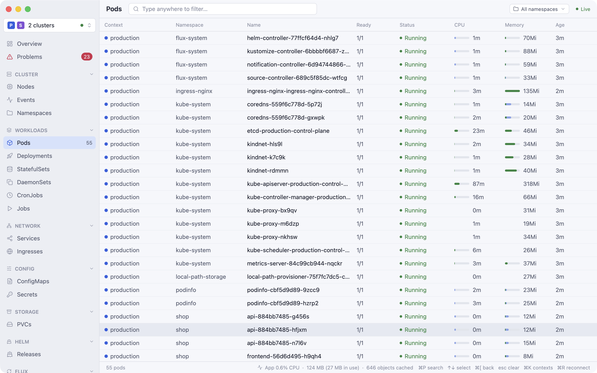 | 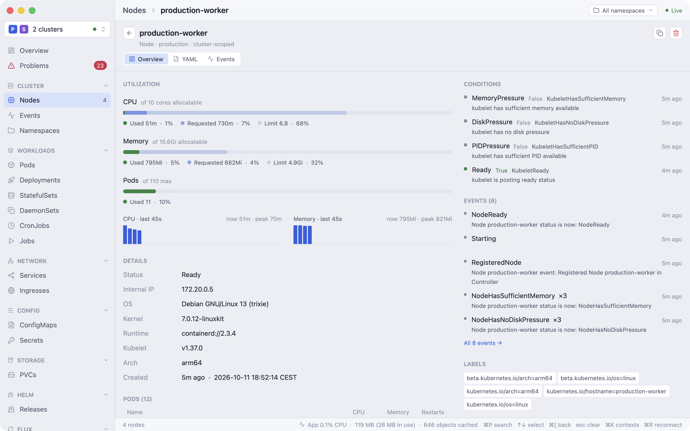 |
| 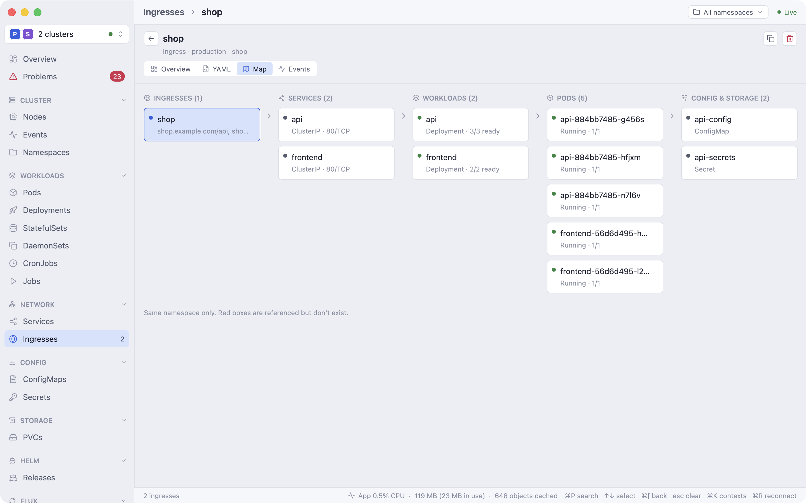 | 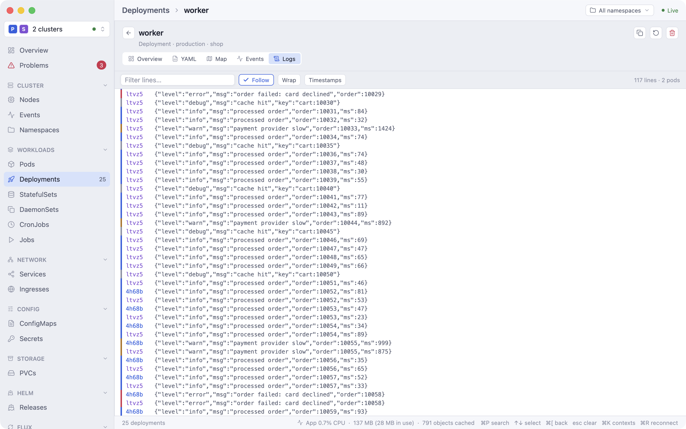 |
| 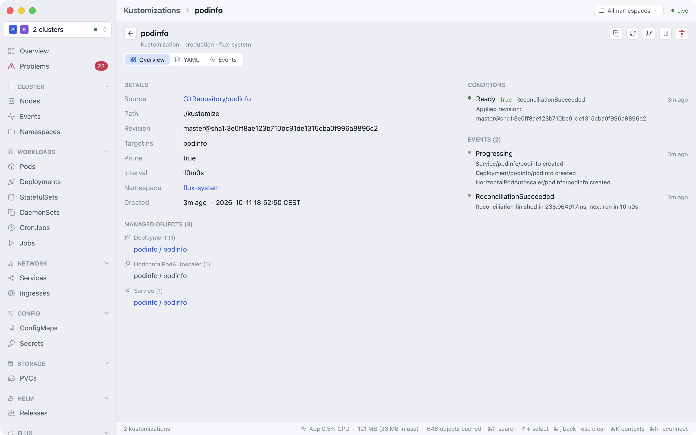 | 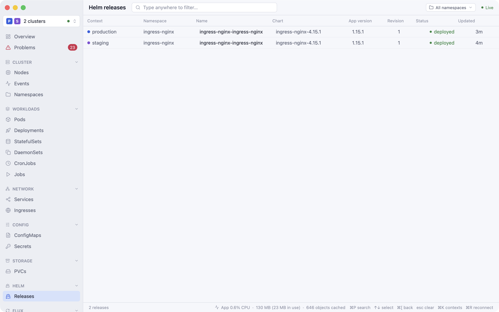 |
| 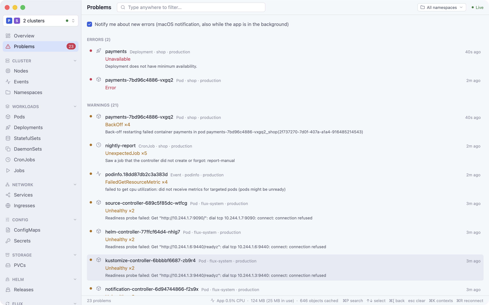 | 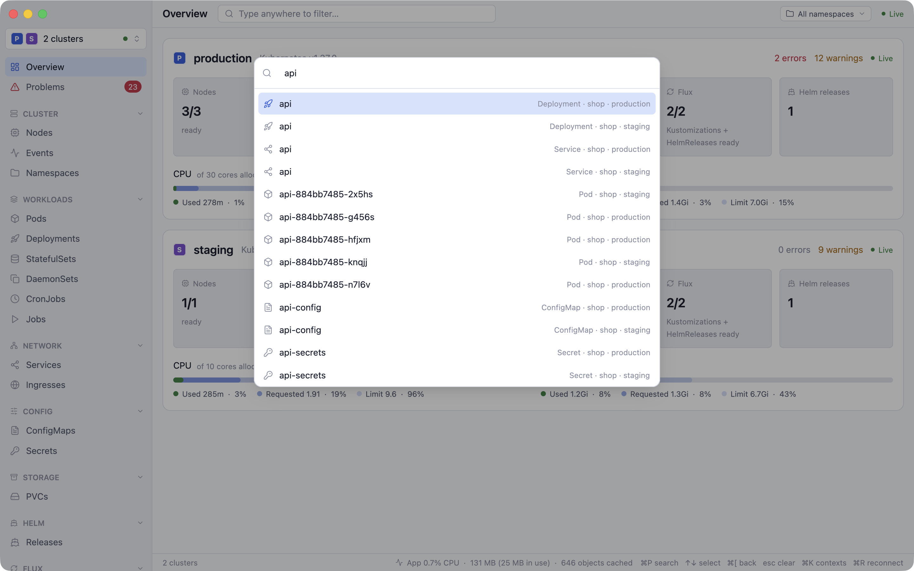 |
| 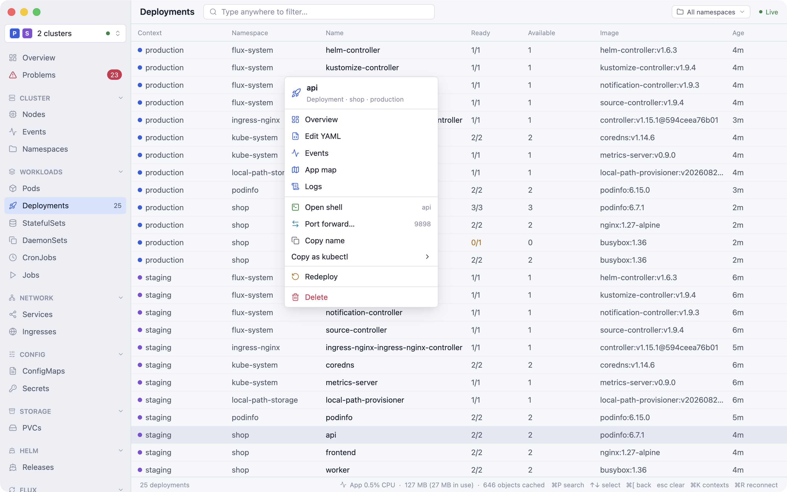 | 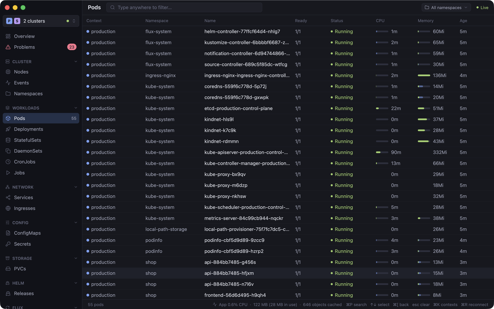 |

## Install

**Download** (Apple Silicon, macOS 13+):

1. Grab `Masthead-macos-arm64.dmg` from the [latest release](https://github.com/Debuggedd/Masthead/releases/latest),
   open it and drag Masthead onto Applications.
2. Open Masthead. macOS says *"Masthead" Not Opened*, because the app isn't notarized by Apple.
   Click **Done**, not "Move to Bin".
3. Open **System Settings → Privacy & Security**, scroll down to *"Masthead" was blocked…*, click
   **Open Anyway** and confirm.

Or skip steps 2 and 3 with one Terminal command:

```sh
xattr -dr com.apple.quarantine /Applications/Masthead.app
```

This is only needed once. Updates install from inside the app and open without the warning.

**Updates:** Masthead checks GitHub for a new release on launch and once a day. When one is out, an
**Update to vX** button appears at the bottom right. It downloads the new version, swaps it in place and
restarts. To check right away, use Masthead → Check for Updates… or click the version number in the
bottom right.

**Build from source:** you need macOS 13+ and a recent stable Rust toolchain. You don't need Xcode's
Metal toolchain, because shaders are compiled at runtime.

```sh
git clone https://github.com/Debuggedd/Masthead.git && cd Masthead
scripts/bundle.sh --install     # builds "Masthead Dev.app" and copies it to ~/Applications
# or just run it:
cargo run --release
```

Local builds are dev builds: named "Masthead Dev" with an orange icon and a DEV badge, and they don't
update themselves, so they can run next to an installed release without mixing them up. Only the
release workflow builds `Masthead.app` (it sets `MASTHEAD_RELEASE=1`).

`rsvg-convert` (`brew install librsvg`) is optional. It renders a sharper app icon from the SVG.

Releases are signed with a fixed (self-signed) certificate, so macOS remembers permissions such as
Documents access across updates. A self-built app is ad-hoc signed instead, so macOS asks again after
every rebuild. To avoid that, create a code-signing certificate called **"Masthead Signing"** in Keychain
Access (Certificate Assistant → Create a Certificate → Code Signing). `bundle.sh` uses it automatically.

## Usage

Masthead reads contexts from `$KUBECONFIG`, or from `~/.kube/config` if that isn't set. Open the
context switcher at the top left (⌘K) to tick contexts or add more kubeconfig files.

| Key | |
|---|---|
| type anywhere | filter the current page (space-separated terms must all match) |
| ⌘P | search everything |
| ⌘K | contexts |
| ⌘, | settings |
| ↑ ↓ / Enter | select / open |
| Esc, ⌘[ | back / clear filter / clear selection |
| ⌘-click, ⇧-click, ⌘A | multi-select rows for bulk actions |
| ⌘S | save in the YAML editor |
| ⌘R | reconnect |

Settings are stored in `~/Library/Application Support/Masthead/`.

<details>
<summary><b>Feature details</b></summary>

- **Contexts**: kubeconfig files added in the context switcher stay where they are; their paths are
  remembered in `~/Library/Application Support/Masthead/kubeconfigs`. In the file picker, ⌘⇧. shows hidden
  folders like `~/.kube`. The selection is remembered across restarts.
- **Resources**: Nodes, Events, Namespaces, Pods, Deployments, StatefulSets, DaemonSets, CronJobs, Jobs,
  ReplicaSets, Services, Ingresses, NetworkPolicies, ConfigMaps, Secrets, HPAs, PDBs, ResourceQuotas,
  LimitRanges, PVCs, PVs, StorageClasses, ServiceAccounts, Roles, RoleBindings, ClusterRoles and
  ClusterRoleBindings, plus every CRD. The less common ones (ReplicaSets, NetworkPolicies, quotas, storage
  and access control) load when you first open them.
- **Namespace filter** (top right): pick one or more namespaces. Every namespaced page then shows only
  those; cluster-scoped pages are unaffected.
- **Sorting**: click a column header. Each page remembers its sort. Events default to newest first, and
  so do Jobs.
- **Overview**: Kubernetes version, nodes ready, pods running or failing, deployments ready, Flux and
  Helm status, error and warning counts, and cluster-wide CPU and memory against allocatable.
- **Problems**: failing, crash-looping or stuck pods, recent restarts, NotReady or pressured nodes,
  unavailable workloads, failed jobs, pending or lost PVCs, Flux objects that have been not Ready for 5
  minutes or are suspended, and warning events from the last 30 minutes. New errors trigger a macOS
  notification. A cluster's first minute counts as the baseline, so selecting a cluster that already has
  errors doesn't notify. Flux's routine blips (a dependent waiting on `DependencyNotReady` while its
  dependency reconciles) aren't reported; a broken dependency shows up itself.
- **Detail pages** have these tabs:
  - **Overview**: node utilization with the pods on it, containers with usage against request and limit,
    related pods, events and labels.
  - **YAML**
  - **Events**
  - **Logs**
  - **Map**
- **Edit YAML**: line numbers, undo and ⌘F. Saving replaces the object with its resourceVersion, so a
  concurrent change gives a conflict instead of an overwrite. Unsaved edits stay as drafts.
- **Port forwards**: a dialog suggests a free local port and offers "open in browser". Services and
  workloads resolve to a ready pod, like `kubectl` does. Running forwards are listed in the sidebar and
  end when the app quits.
- **Shell**: `kubectl exec -it` opens in a new tab of your running Ghostty through its AppleScript API.
  If Ghostty isn't installed, Terminal.app is used.
- **Debug shells**: on a pod, "Debug container" adds an ephemeral busybox container that shares the target
  container's processes (`kubectl debug`), for images without a shell. On a node, "Node shell" starts a
  privileged pod on that node and enters the host as root; the pod is removed when you exit.
- **Flux**: Reconcile, Reconcile with source (refreshes the GitRepository, OCIRepository, HelmRepository
  or HelmChart first), Suspend and Resume. Kustomizations and HelmReleases list their managed objects.
- **Secrets / ConfigMaps**: every key is listed, and values can be selected and scrolled. Secret values
  re-hide when you move on. You can copy a value without revealing it.

</details>

## Development

```sh
cargo test                       # unit tests
cargo test -- --ignored          # live smoke tests against your current context (or MASTHEAD_TEST_CONTEXT)
```

**Mock clusters for screenshots and demos.** `scripts/demo_cluster.sh` creates two
[kind](https://kind.sigs.k8s.io) clusters, `staging` and `production`. They run a fake shop app,
metrics-server, Flux, a Helm release and one deliberately broken deployment. Run the app against them
with its own `HOME`, so your real contexts and settings stay out of the picture:

```sh
scripts/demo_cluster.sh                       # needs docker, kind, kubectl, flux
export HOME=/tmp/masthead-demo KUBECONFIG=/tmp/masthead-demo/kubeconfig
MASTHEAD_OPEN='Nodes/production-worker#overview' scripts/screenshot.sh out.png 1440x900
scripts/demo_cluster.sh down
```

Build the release binary with `cargo build --release` before setting `HOME`, because cargo and rustup
live in your real home directory.

Debug hooks used by those scripts:

- `MASTHEAD_SIZE=WxH` opens a floating window of that size.
- `MASTHEAD_OPEN=Kind/name#tab` opens a page. It also accepts `Overview`, `Problems`, `Helm/name`, `Search:query` and `#menu`.
- `MASTHEAD_KEYS=a,b,cmd-p,wait:500` replays keystrokes.
- `MASTHEAD_APPEARANCE=dark` forces light or dark mode.
- `MASTHEAD_RELEASES_URL=file:///path/latest.json` checks a fake release instead of GitHub (tests the updater).

**Layout.** `src/k8s.rs` holds the cluster side: watches, cache, metrics, logs, actions and port
forwarding. `src/main.rs` holds the whole UI.

**Releases.** Bump `version` in `Cargo.toml`, then push a matching tag such as `v0.2.0`. GitHub
Actions builds `Masthead.app` and attaches it to a release, and running apps offer it as an update. CI runs `cargo fmt --check`, clippy (warnings are errors) and the tests on every push.

## Built with

- [GPUI](https://www.gpui.rs) and [gpui-component](https://github.com/longbridge/gpui-component)
- [kube-rs](https://kube.rs) and [k8s-openapi](https://github.com/Arnavion/k8s-openapi)
- [Lucide](https://lucide.dev) icons
- [tree-sitter-yaml](https://github.com/tree-sitter-grammars/tree-sitter-yaml)

## License

[MIT](LICENSE). The bundled [Lucide](https://lucide.dev) icons are under the [ISC license](assets/icons/LICENSE).
